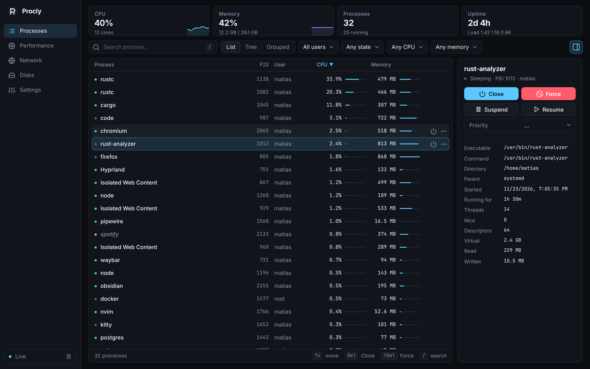
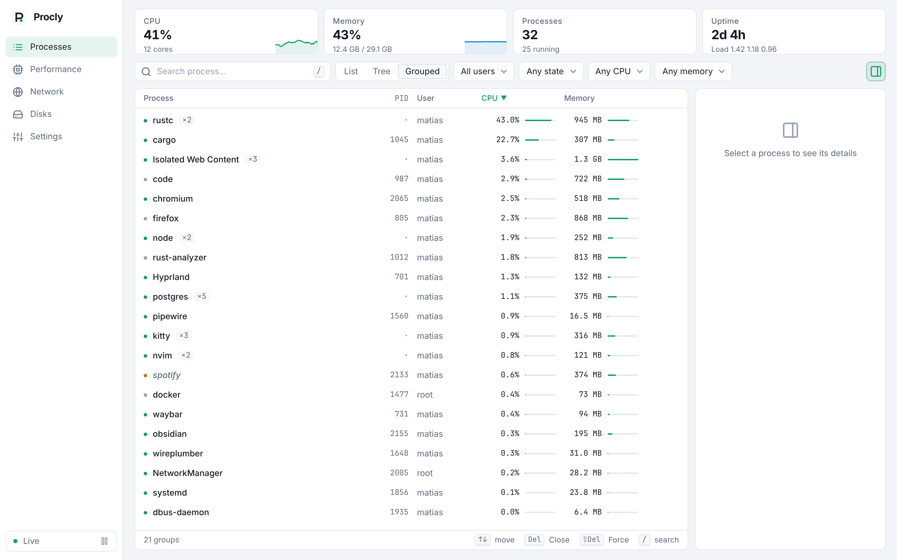
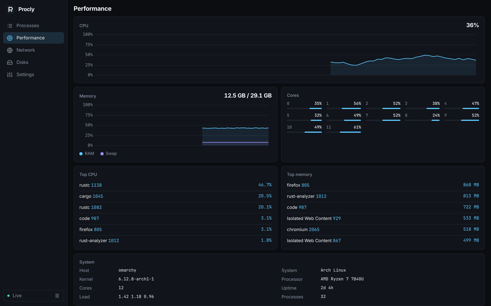
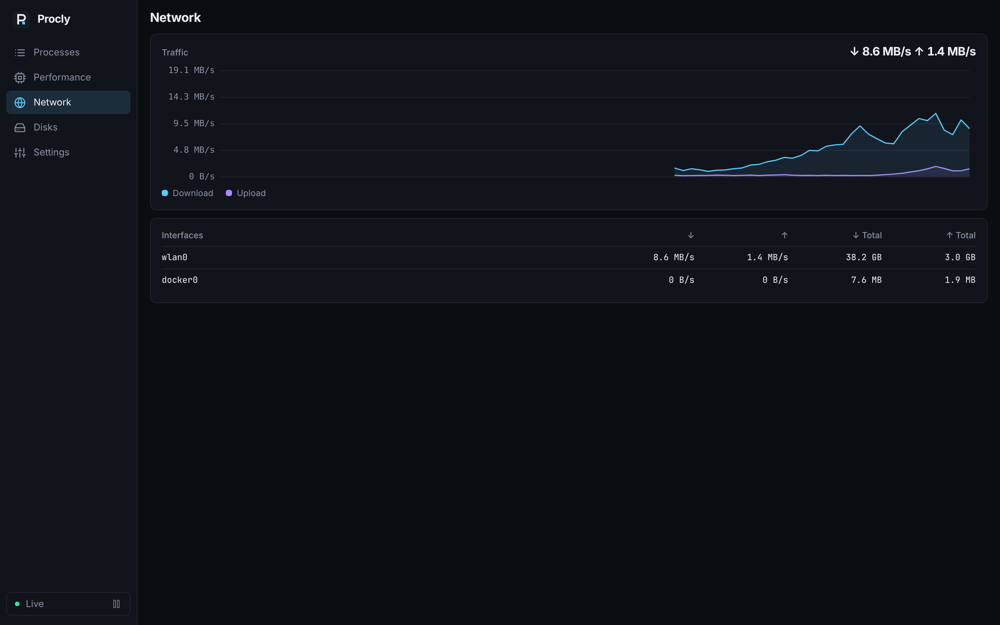
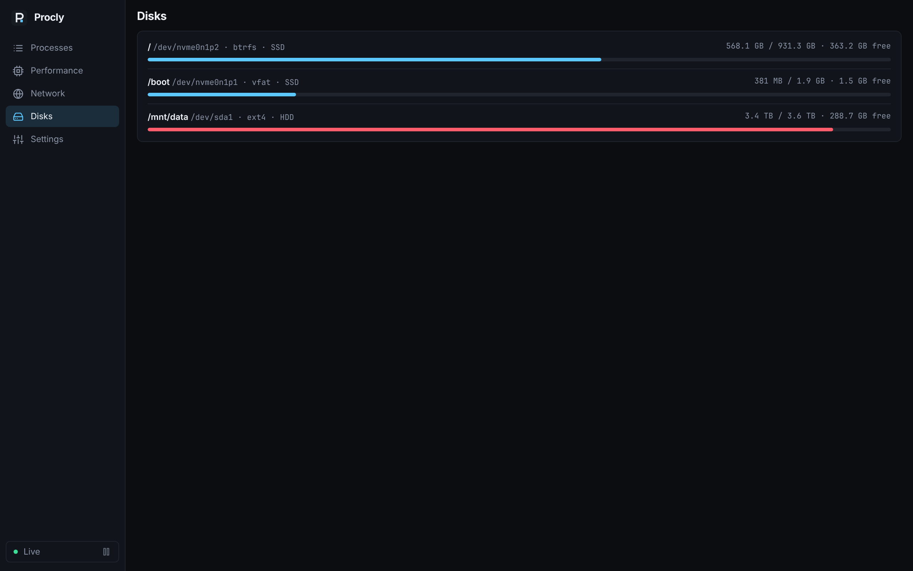
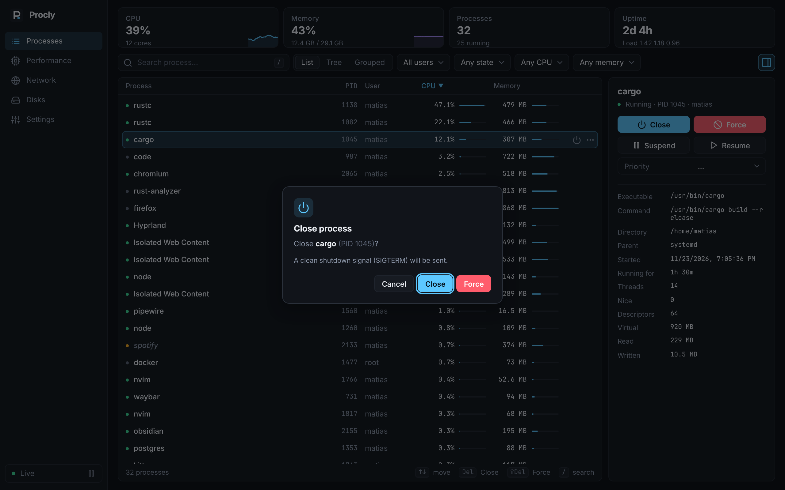
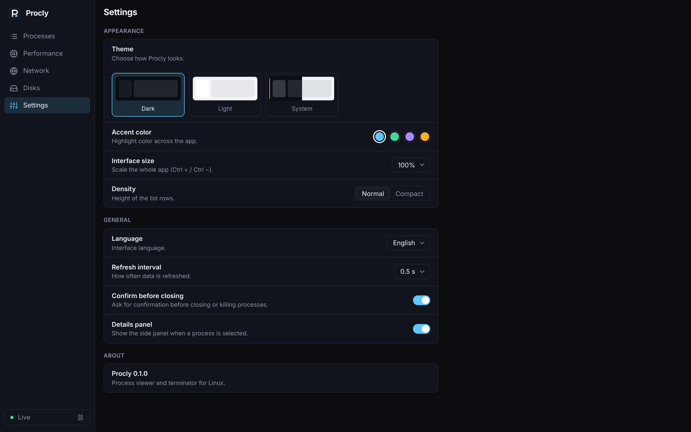

<p align="center"></p>

<p align="center">
  Visor y terminador de procesos para Linux, rápido y minimalista.<br>
  Hecho con Rust + Tauri v2. Diseño plano, sin glow, tema oscuro y claro.
</p>

<p align="center">
  
  
  
  
</p>

<p align="center"><a href="README.md">Read in English</a></p>

<p align="center"></p>

## Características

- **Procesos** — vistas de lista, árbol o agrupada por aplicación. Filtros por texto, usuario, estado, CPU y memoria. Orden por cualquier columna.
- **Acciones** — cerrar (SIGTERM), forzar (SIGKILL), suspender / reanudar y cambiar prioridad (nice). Selección múltiple y menú contextual.
- **Panel de detalles** — ejecutable, comando, directorio, padre, hilos, descriptores, E/S y tiempo en ejecución.
- **Rendimiento** — gráficos en vivo de CPU y memoria/swap, uso por núcleo, mayores consumidores y datos del sistema.
- **Red y discos** — tráfico en vivo por interfaz y uso por punto de montaje.
- **Ajustable** — tema oscuro / claro / sistema, cuatro colores de acento, tamaño de la interfaz (80–150 %), densidad de filas e intervalo de refresco.
- **Multilingüe** — Español, English, Português.
- **Rápido** — backend nativo en Rust, lista virtualizada y frontend sin bundler ni dependencias.

## Capturas

| | |
|---|---|
|  |  |
| Vista agrupada, tema claro con acento verde | Rendimiento |
|  |  |
| Red | Discos |
|  |  |
| Confirmación antes de cerrar | Ajustes |

> Las capturas usan datos simulados (`scripts/screenshots.cjs`), no una máquina real. La interfaz aparece en inglés; cámbiala en Ajustes.

## Instalar (Arch Linux / Omarchy)

```bash
git clone https://github.com/MatiasFrutos/Procly
cd Procly
./scripts/install.sh
```

El script instala con `pacman` las dependencias que falten, compila en modo release e instala el binario en
`~/.local/bin/procly` junto con el icono y la entrada del lanzador.

| Opción | Efecto |
|---|---|
| `--system` | Instala para todo el sistema (`/usr/local`, usa `sudo`) |
| `--no-build` | Reutiliza el binario ya compilado |
| `--skip-deps` | No comprueba ni instala dependencias |
| `--uninstall` | Elimina Procly |

Atajo opcional en Hyprland (`~/.config/hypr/bindings.conf`):

```ini
bindd = SUPER SHIFT, P, Procly, exec, procly
```

## Compilar desde el código

Dependencias en Arch: `rust nodejs npm webkit2gtk-4.1 gtk3 librsvg libsoup3 base-devel`.
Otras distribuciones: [requisitos de Tauri](https://v2.tauri.app/start/prerequisites/#linux).

```bash
npm install
npm run dev      # ventana de desarrollo
npm run build    # build release (paquetes en src-tauri/target/release/bundle)
```

## Atajos de teclado

| Tecla | Acción |
|---|---|
| `↑` `↓` (`⇧` para extender) | Mover selección |
| `Ctrl`+clic / `Ctrl+A` | Selección múltiple / todo |
| `/` | Buscar |
| `Supr` / `⇧Supr` | Cerrar / forzar (con confirmación) |
| `Enter` / `⇧Enter` (en el diálogo) | Cierre limpio / forzar |
| `Alt+1…5` | Cambiar de pestaña |
| `Ctrl` `+` / `-` / `0` | Tamaño de la interfaz |
| `Esc` | Cancelar, limpiar búsqueda o selección |

## Seguridad

Procly solo envía señales que el sistema permite: sin root solo puedes actuar sobre tus propios procesos.
PID 1 y el propio Procly están protegidos, y cerrar pide confirmación (se puede desactivar en Ajustes).

## Estructura

```
src/            Frontend (HTML / CSS / JS plano, sin bundler)
src-tauri/      Backend en Rust (sysinfo) y configuración de Tauri
scripts/        install.sh, screenshots.cjs, make-public.sh
assets/         Fuentes del logo e icono
docs/           Capturas
```

## Licencia

[MIT](LICENSE)
