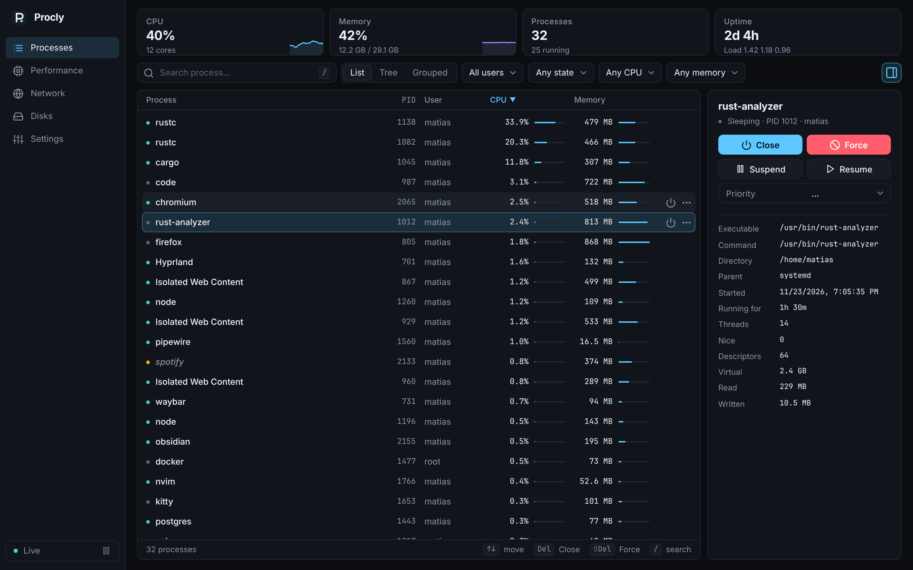
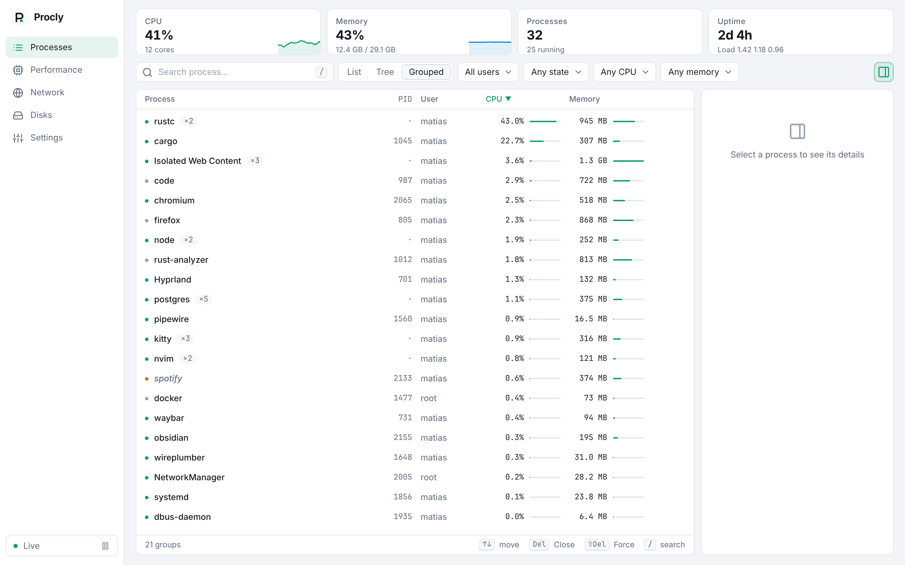
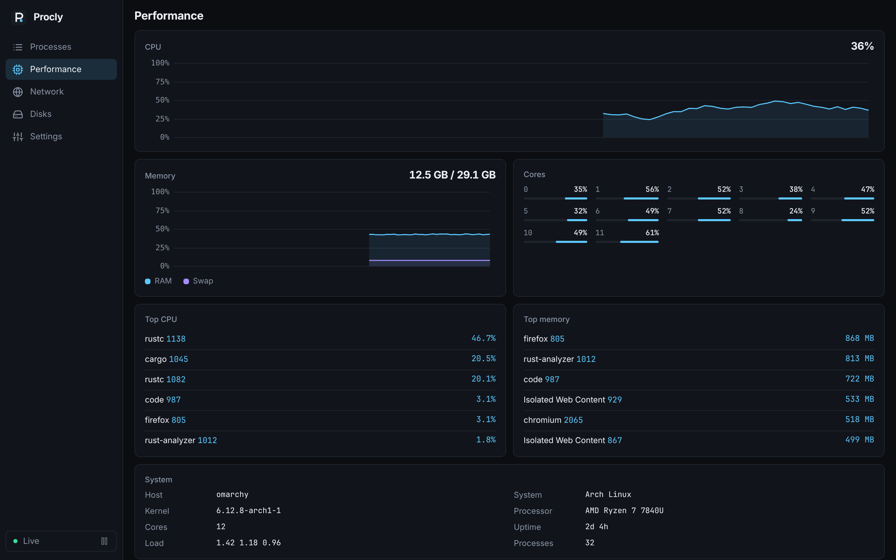
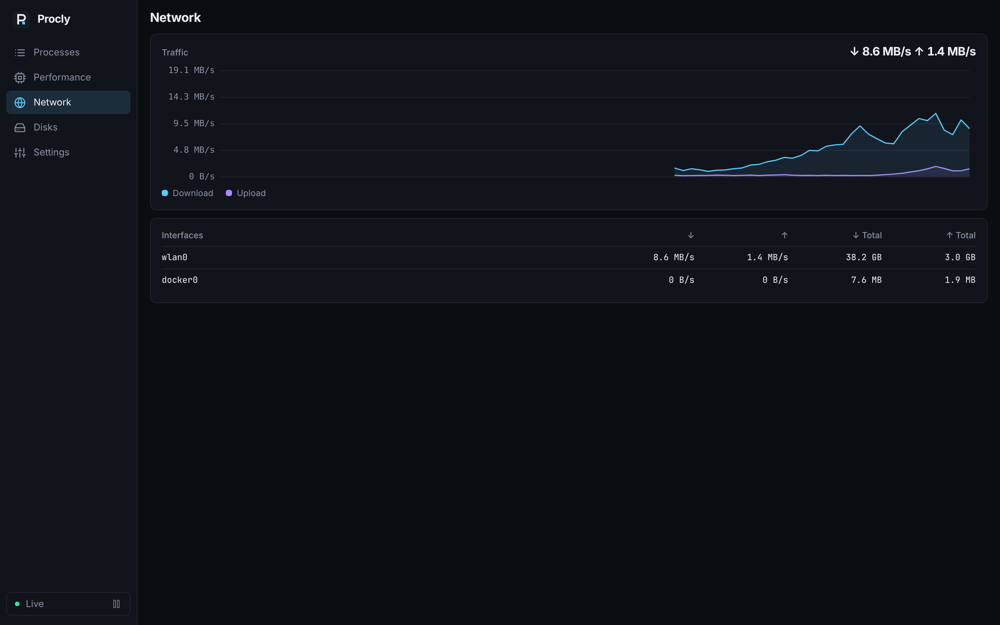
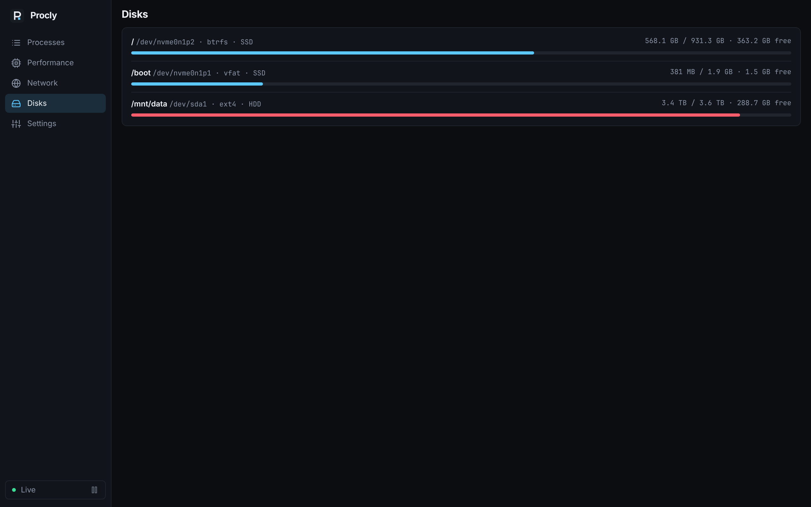
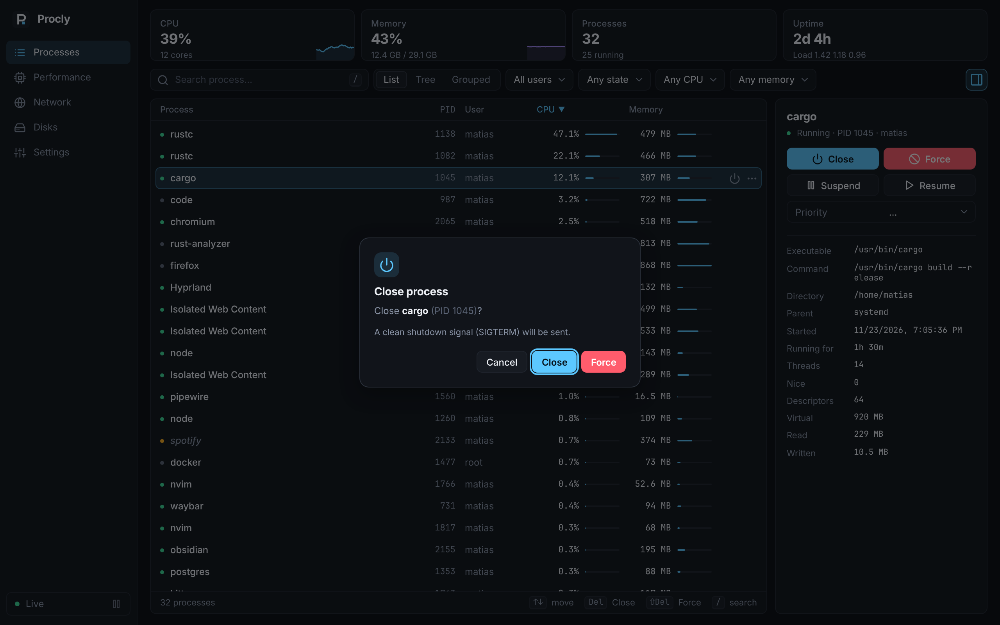
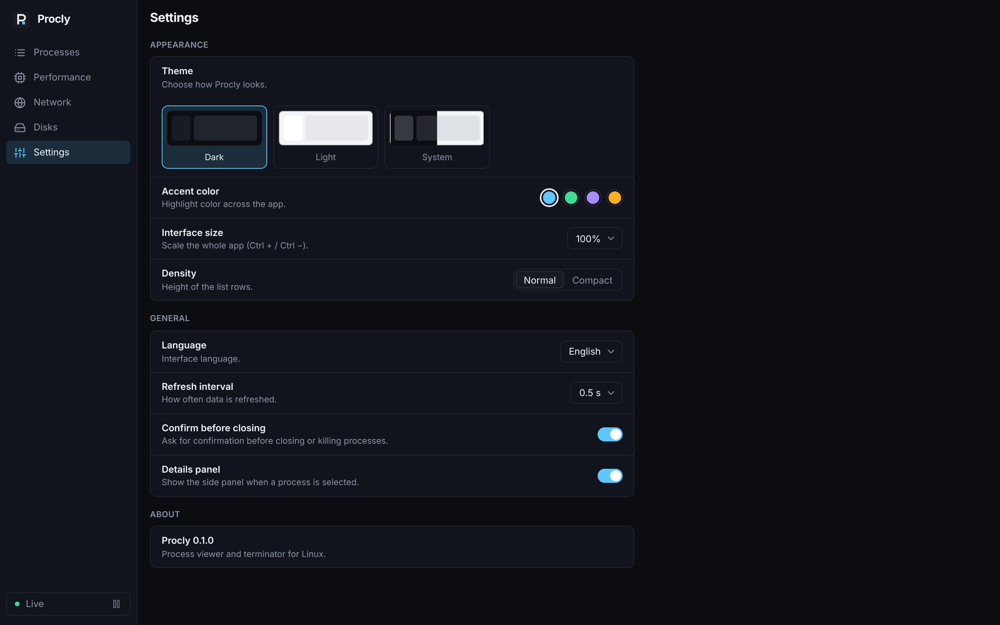

<p align="center"></p>

<p align="center">
  A fast, minimal process viewer and terminator for Linux.<br>
  Built with Rust + Tauri v2. Flat, no glow, dark and light themes.
</p>

<p align="center">
  
  
  
  
</p>

<p align="center"><a href="README.es.md">Leer en español</a></p>

<p align="center"></p>

## Features

- **Processes** — list, tree or grouped-by-app views. Filter by text, user, state, CPU and memory. Sort by any column.
- **Act on them** — close (SIGTERM), force kill (SIGKILL), suspend / resume, change priority (nice). Multi-select and a right-click menu.
- **Details panel** — executable, command line, working directory, parent, threads, file descriptors, I/O totals, run time.
- **Performance** — live CPU and memory/swap charts, per-core usage, top CPU / memory consumers, system info.
- **Network & disks** — live traffic per interface and usage per mount point.
- **Made to be adjusted** — dark / light / system theme, four accent colors, interface size (80–150 %), row density, refresh interval.
- **Multilingual** — English, Español, Português.
- **Fast** — native Rust backend, virtualized list, no bundler and no runtime dependencies in the frontend.

## Screenshots

| | |
|---|---|
|  |  |
| Grouped view, light theme with a green accent | Performance |
|  |  |
| Network | Disks |
|  |  |
| Confirmation before closing | Settings |

> Screenshots use simulated data (`scripts/screenshots.cjs`), not a real machine.

## Install (Arch Linux / Omarchy)

```bash
git clone https://github.com/MatiasFrutos/Procly
cd Procly
./scripts/install.sh
```

The script installs missing dependencies with `pacman`, builds a release binary and installs it to
`~/.local/bin/procly` together with the icon and a launcher entry.

| Option | Effect |
|---|---|
| `--system` | Install system-wide (`/usr/local`, uses `sudo`) |
| `--no-build` | Reuse the binary that is already built |
| `--skip-deps` | Don't check or install dependencies |
| `--uninstall` | Remove Procly |

Optional Hyprland keybinding (`~/.config/hypr/bindings.conf`):

```ini
bindd = SUPER SHIFT, P, Procly, exec, procly
```

## Build from source

Dependencies on Arch: `rust nodejs npm webkit2gtk-4.1 gtk3 librsvg libsoup3 base-devel`.
Other distributions: see the [Tauri prerequisites](https://v2.tauri.app/start/prerequisites/#linux).

```bash
npm install
npm run dev      # development window
npm run build    # release build (bundles in src-tauri/target/release/bundle)
```

## Keyboard shortcuts

| Key | Action |
|---|---|
| `↑` `↓` (`⇧` to extend) | Move selection |
| `Ctrl`+click / `Ctrl+A` | Multi-select / select all |
| `/` | Search |
| `Del` / `⇧Del` | Close / force kill (with confirmation) |
| `Enter` / `⇧Enter` (in the dialog) | Clean close / force kill |
| `Alt+1…5` | Switch tab |
| `Ctrl` `+` / `-` / `0` | Interface size |
| `Esc` | Cancel, clear search or selection |

## Safety

Procly only sends signals the operating system allows: without root you can act on your own processes only.
PID 1 and Procly itself are protected, and closing asks for confirmation (can be turned off in Settings).

## Project layout

```
src/            Frontend (plain HTML / CSS / JS, no bundler)
src-tauri/      Rust backend (sysinfo) and Tauri configuration
scripts/        install.sh, screenshots.cjs, make-public.sh
assets/         Logo and icon sources
docs/           Screenshots
```

## License

[MIT](LICENSE)
